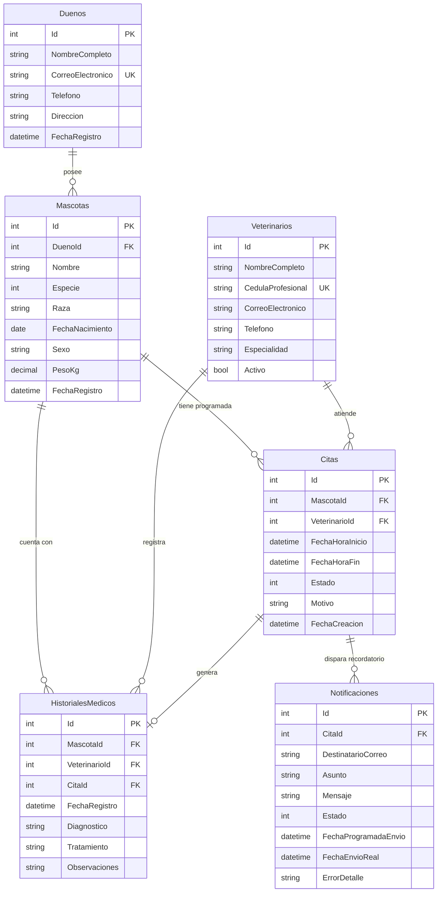

# VetSync - Sistema de Gestión de Citas y Telemedicina Veterinaria

[](https://github.com/tu-usuario/VetSync/actions/workflows/ci.yml)


**VetSync** es una plataforma integral de gestión clínica veterinaria y agendamiento inteligente diseñada bajo los principios de **Clean Architecture**, **SOLID** y **Desarrollo Guiado por Pruebas (TDD)**. Proporciona control estricto sobre horarios profesionales, historiales clínicos de pacientes y automatización de recordatorios de citas con tolerancia a fallos.

---

## 1. Requerimientos de Negocio Cumplidos

1. **Gestión de Pacientes y Dueños con Historial Médico**:
   - Registro normalizado de propietarios y pacientes (perros, gatos, aves, etc.).
   - Trazabilidad de diagnósticos, tratamientos y observaciones veterinarias asociadas a citas clínicas.
2. **Agendamiento Inteligente sin Choque de Horarios**:
   - Prevención de solapamientos horarios para veterinarios mediante validaciones a nivel de dominio y persistencia.
   - Manejo de casos de borde: citas consecutivas contiguas permitidas, traslapes de 1 minuto rechazados, validación de fechas futuras y veterinarios activos.
3. **Módulo de Notificaciones Simulado**:
   - Monitoreo y despacho de recordatorios por correo para citas próximas (ventana de 24 horas).
   - Auditoría de notificaciones con resiliencia ante caídas del emisor de correos.
4. **Diseño Desacoplado y Arquitectura Modular**:
   - Separación estricta de responsabilidades en capas independientes de .NET.
   - Cobertura de pruebas unitarias superior al 80% (alcanzando 99.38%) y control de calidad mediante CI/CD.

---

## 2. Arquitectura de la Solución (Clean Architecture)

El proyecto implementa **Clean Architecture** dividida en 5 proyectos con dependencias unidireccionales:

```text
VetSync.slnx
├── src/
│   ├── VetSync.Domain/          # Núcleo de negocio puro (Entidades, Enums, Excepciones)
│   ├── VetSync.Application/     # Casos de uso, DTOs, Validadores (FluentValidation), Interfaces
│   ├── VetSync.Infrastructure/  # Persistencia (EF Core SQL Server), Repositorios, Servicios Externos
│   └── VetSync/ (VetSync.Web)   # Presentación (Controladores MVC, Razor Pages, Middlewares)
└── tests/
    └── VetSync.Tests/           # Suite de pruebas unitarias con xUnit, Moq y FluentAssertions
```

### Principios SOLID Aplicados
- **Single Responsibility (SRP)**: Separación estricta entre modelos de dominio, validaciones de negocio, consultas de datos y controladores web.
- **Open/Closed (OCP)**: Servicios desacoplados mediante abstracciones (`IEmailSenderService`, `IGenericRepository<T>`), permitiendo extender la persistencia o el transporte de notificaciones sin modificar el núcleo.
- **Liskov Substitution (LSP)**: Repositorios genéricos y específicos intercambiables por implementaciones en memoria o mocks sin alterar el comportamiento.
- **Interface Segregation (ISP)**: Interfaces cohesivas y especializadas (`ICitaRepository`, `IMascotaRepository`, `IUnitOfWork`).
- **Dependency Inversion (DIP)**: Las capas internas dependen exclusivamente de abstracciones definidas en `VetSync.Application.Interfaces`.

---

## 3. Modelo de Datos y Esquema Relacional



---

## 4. Requisitos Previos e Instalación

### Requisitos del Sistema
- [.NET 10.0 SDK](https://dotnet.microsoft.com/download/dotnet/10.0) o superior.
- [SQL Server](https://www.microsoft.com/sql-server) (LocalDB, Express o Docker).
- Git.

### Pasos de Configuración

1. **Clonar el repositorio**:
   ```bash
   git clone https://github.com/tu-usuario/VetSync.git
   cd VetSync
   ```

2. **Configurar la cadena de conexión mediante User Secrets**:
   En el proyecto web `VetSync` ejecutar:
   ```bash
   dotnet user-secrets set "ConnectionStrings:DefaultConnection" "Server=localhost,1433;Database=VetSyncDB;User Id=sa;Password=TuPasswordSeguro123!;TrustServerCertificate=true;" --project VetSync/VetSync.Web.csproj
   ```

3. **Restaurar dependencias y compilar**:
   ```bash
   dotnet restore VetSync.slnx
   dotnet build VetSync.slnx
   ```

4. **Ejecutar la aplicación**:
   ```bash
   dotnet run --project VetSync/VetSync.Web.csproj
   ```
   *(La aplicación aplica automáticamente las migraciones pendientes en base de datos al inicializar el contenedor).*

---

## 5. Metodología TDD y Pruebas Unitarias

El proyecto cuenta con **38 pruebas unitarias** desarrolladas siguiendo el ciclo **Red-Green-Refactor**:

```bash
dotnet test VetSync.Tests/VetSync.Tests.csproj --collect:"XPlat Code Coverage"
```

### Cobertura de Código
- **Cobertura Global de Líneas**: **99.38%** (Umbral mínimo exigido: **80.0%**).
- **Herramientas**: xUnit, Moq, FluentAssertions y Coverlet.
- **Suites de prueba**:
  - `CitaServiceTests`: Solapamiento de horarios, fechas pasadas, mascotas inexistentes, citas contiguas.
  - `CitaServiceConsultasTests`: Consultas de citas por ID y agenda por veterinario.
  - `MascotaServiceTests`: Registro de mascotas, validación de peso, registro de historial clínico.
  - `MascotaServiceConsultasTests`: Registro de dueños, prevención de correos duplicados, consultas clínicas.
  - `NotificacionServiceTests`: Envío de recordatorios próximos, tolerancia a fallos en transporte.
  - `DomainEntitiesTests`: Regla de solapamiento en entidad `Cita` y excepciones de dominio.
  - `DtoValidatorsTests`: Validación estricta con FluentValidation.

---

## 6. Pipeline de Integración Continua (CI/CD)

Ubicado en [`.github/workflows/ci.yml`](.github/workflows/ci.yml):
- **Disparador**: Cada `push` o `pull_request` sobre la rama `main`.
- **Pasos Automatizados**:
  1. Restauración de paquetes NuGet.
  2. Linter de formato de código (`dotnet format --no-restore --verify-no-changes`).
  3. Compilación de la solución en modo Release.
  4. Ejecución de pruebas unitarias con recolección de cobertura Cobertura XML.
  5. **Quality Gate Estricto**: Script que calcula la cobertura real; si es inferior al **80%**, el pipeline falla y bloquea el merge.
  6. Publicación de artefactos de prueba para auditoría.

---

## 7. Convenciones de Código

- **Nomenclatura**: PascalCase para clases, métodos y propiedades públicas; camelCase con guion bajo (`_`) para campos privados.
- **Idioma del Dominio**: Entidades y propiedades en español (`Dueno`, `Mascota`, `FechaHoraInicio`); sufijos de patrones en inglés (`Repository`, `Service`, `Controller`, `Dto`).
- **Tipado Fuerte**: Prohibido el uso de `dynamic` u `object` genérico. Toda respuesta utiliza la envoltura [`ServiceResponse<T>`](VetSync.Application/Common/Models/ServiceResponse.cs).
- **Manejo Global de Errores**: Middleware centralizado [`ManejadorExcepcionesMiddleware`](VetSync/Middlewares/ManejadorExcepcionesMiddleware.cs).
